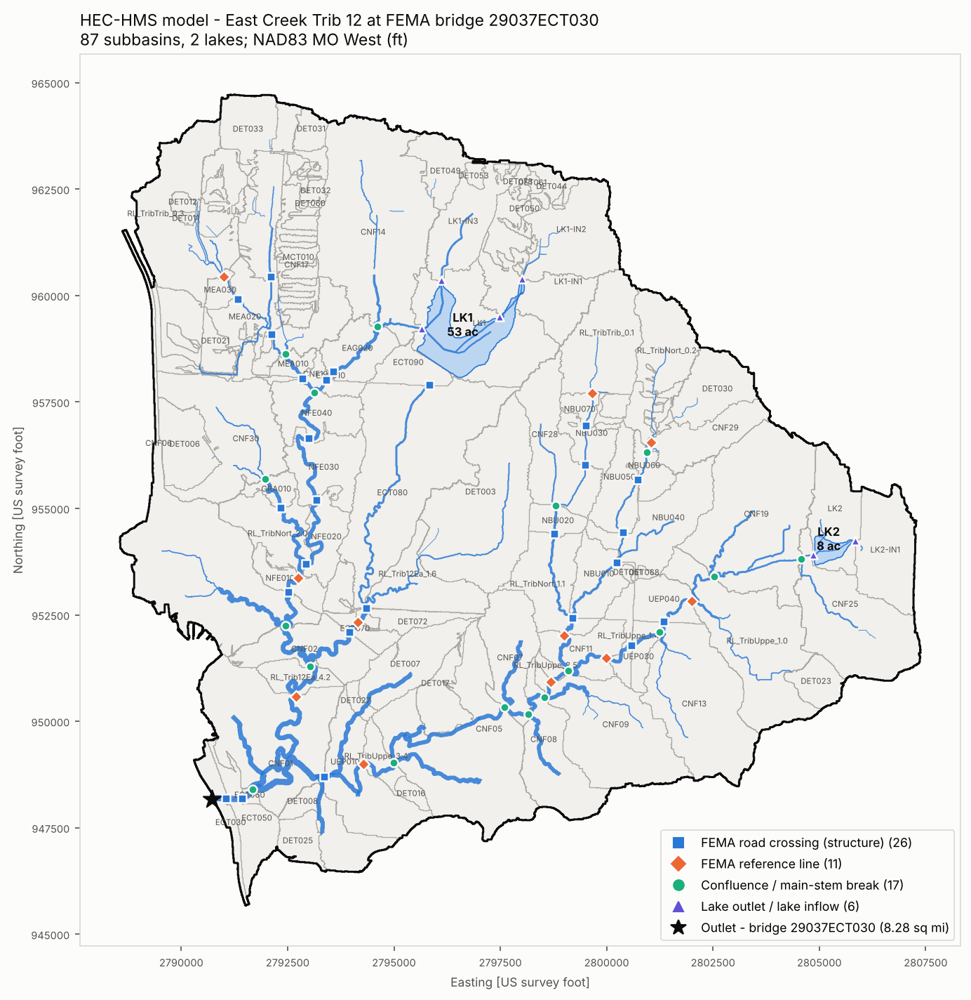
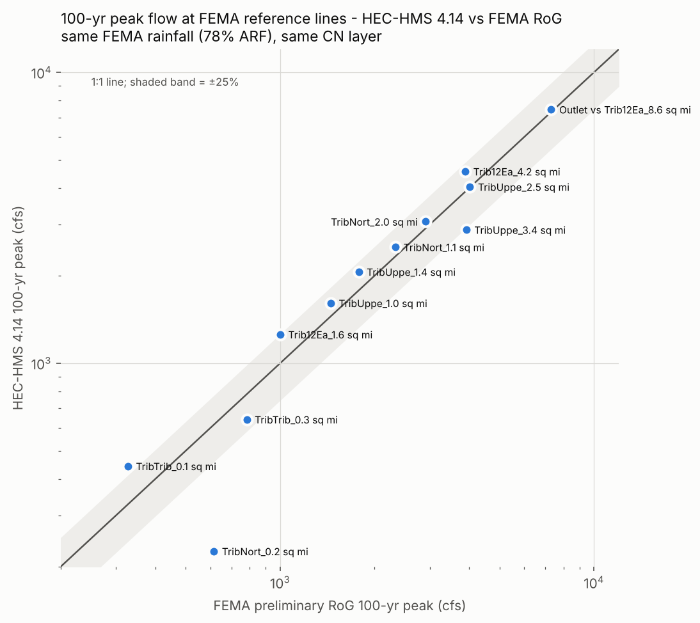

# RAIN – East Creek Trib 12 watershed analysis (Raymore, Cass County, MO)

A detailed watershed analysis built from FEMA's preliminary Rain-on-Grid (RoG)
HEC-RAS model. **Phase 1 builds and runs a HEC-HMS 4.14 model** of the
watershed draining to the point the analysis is centered on:

| | |
|---|---|
| Outlet | 38.770832, −94.492901 → FEMA bridge **29037ECT030** on East Creek Trib 12 (Missouri State Plane West ft: 2,790,727 E, 948,173 N) |
| Drainage area | **8.28 sq mi** (5,296 ac), entirely inside the FEMA 2D area (45.4 sq mi) |
| HMS elements | 87 subbasins, 82 Muskingum-Cunge reaches, 2 lakes + 26 detention basins (level-pool), 115 junctions |
| Subbasins | Terrain (culverts burned) **plus the city storm sewer**: inlets route to their pipe outfalls, moving 274 ac between subbasins ([details](docs/StormSewer_Delineation.md)) |
| Detention | **26 basins** from the city storm GIS as level-pool elements (76.9 ac-ft), 3 with as-built outlets; most subdivisions do not detain. Outlet peak −3.2 % (FEMA 100-yr) ([details](docs/Detention.md)) |
| Land cover | 44 % lawn, 22 % trees, 13 % roads, 8 % crops, 5 % buildings, 5 % bare ground, 2 % water |
| Soils | 51 % C/D, 33 % C, 9 % D, 5 % B (SSURGO via FEMA `Soils.hdf`) |
| Loss | SCS CN from FEMA's own CN table: 20.5 % impervious, pervious CN 80.8 (composite 84.3) |
| Storms | 10, 25, 50, 100, 100+ (upper-CI) and 500-yr; FEMA hyetographs as-is **and** at Atlas 14 point depth |



## Things found in the FEMA model that matter

1. **FEMA's rainfall is area-reduced by 0.782**, even though the RAS project
   description says "non-reduced". Every FEMA hyetograph in
   `Precip Data/78% AR/Rainfall.dss` totals exactly 0.782 × the Atlas 14 point
   depth in `Precip.gdb` (100-yr: 7.02 in vs 8.97 in). A 22 % reduction is a
   large-area factor. For an 8 sq mi watershed, and certainly for subdivision
   detention design, it under-states rainfall. The HMS project therefore
   carries both sets: `FEMA_*` (as-is) and `Point_*` (same pattern, Atlas 14
   point depth). Choosing which governs is an engineering decision for you.
2. **The FEMA terrain is not hydro-enforced.** `FinalTerrain.hydroDEM.tif`
   has road embankments 7–8 ft above the culvert inverts. For delineation I
   burned all 97 FEMA culvert barrels (surveyed inverts) into the 1 m terrain.
   With that, 33 of 37 FEMA reference lines reproduce their names' drainage
   areas within ±4 %.
3. **FEMA's `Trib12Ea_0.7sqmi` / `TribNort_2.0sqmi` labels assume Silver Lake
   drains south to Trib 12.** The 0.7 sq mi is the lake's own drainage area.
   The terrain, FEMA's 2D results, the Black & Veatch as-builts (spillway at
   Silvertop Ln) and the city's storm GIS (no pipe leaving the lake to the
   south) all have it draining west. The model follows that. Only a private
   principal-spillway pipe through the south dam would change this; see
   [`docs/as-builts/Raymore_city_data.md`](docs/as-builts/Raymore_city_data.md).
4. **Two on-stream lakes** (LK1 52.5 ac, normal pool 1025.47 ft; LK2 8.3 ac,
   1032.78 ft) have no outlet structures in the FEMA model, so they spill over
   the terrain. HMS routes them as level pools whose terrain-derived curves
   reproduce FEMA's 2D peak lake stages within +0.3 to +0.4 ft (LK1) and
   −0.4 to −0.8 ft (LK2) for all six storms. **LK1 is Silver Lake.** Its
   as-builts (Black & Veatch 132691, conformed 2003) confirm the lake spills
   through the existing open channel and triple 12 × 4.3 ft box under
   Silvertop Ln. The culvert doesn't control below about 1,400 cfs, and the
   2002 survey puts the sill about 0.5 ft below the lidar. See
   [`docs/as-builts/Silver_Lake_BV132691.md`](docs/as-builts/Silver_Lake_BV132691.md).
5. FEMA's `Rainfall.dss` stores incremental precipitation with data type
   **INST-VAL**. HEC-RAS accepts that, but HEC-HMS rejects it for a
   precipitation gage. The HMS project uses a re-written copy with identical
   values stored as PER-CUM.
6. The FEMA structure "Stage HW" output is not usable (values like 1 ft at a
   987 ft invert), so only structure flows were extracted.

## Results (HEC-HMS 4.14)

All 12 runs were computed with HEC-HMS 4.14 (Linux, headless) and finished
with no errors. The warnings are:

* 20 short reaches "may cause numeric instabilities" (the hydrographs show
  none);
* one reach below a detention basin (R-DET051) would need one more subreach
  at high index flows;
* one tiny detention subbasin (SB-DET012) has a lag under the time-step
  criterion.

An independent Python re-implementation of the same methods
(`scripts/hms_check.py`) reproduces the HMS peaks at every junction within
1.3 % and the time of peak within about 1 min, which confirms HMS is computing
what was intended.

100-yr peaks at the FEMA reference lines, using the same FEMA rainfall and CN layer:



Peak flow at the outlet (cfs):

| Event | FEMA RoG @ `Trib12Ea_8.6sqmi` (839 ft downstream) | HMS, FEMA rainfall | HMS, Atlas 14 point rainfall |
|---|---:|---:|---:|
| 10-yr | 2,899 | 3,522 | 5,222 |
| 25-yr | 4,383 | 4,914 | 7,168 |
| 50-yr | 5,837 | 6,142 | 8,822 |
| 100-yr | 7,310 | 7,456 | 10,588 |
| 100-yr+ | 8,970 | 9,115 | 12,826 |
| 500-yr | 11,023 | 10,949 | 15,336 |

Across the 11 reference lines inside the watershed, the median HMS/FEMA peak
ratio is 1.16 (10-yr), 1.08 (100-yr) and 1.01 (500-yr). HMS runs high in
frequent storms because the 2D model stores water in every lidar depression
and behind every road embankment. HMS now routes the 26 detention basins that
store meaningful water (`docs/Detention.md`), but not road-embankment storage;
that is one of the next phases (below).

One location runs the other way: at `TribUppe_3.4` HMS is 27 % (100-yr) to
34 % (500-yr) **below** FEMA. Reach `R-CNF07` upstream of it is a 4,200 ft
wooded floodplain with about 2 ft of fall, and its single fitted trapezoid
(121 ft bottom, 60:1 sides) over-attenuates in Muskingum-Cunge. An 8-point
(channel + overbank) section would fix this; it's on the list below.

Full tables are in `HMS/Results/`; QA-engine detail is in `HMS/QAQC/`.

## Running HEC-HMS

* **On your PC:** open `HMS/Raymore_Trib12/Raymore_Trib12.hms` in HEC-HMS
  4.14 and compute any run.
* **In a Claude Code cloud session:** `.claude/settings.json` allows one
  command, a headless HMS run from `/root/hec-hms`. HMS isn't kept between
  sessions, so it is downloaded first, then all 12 runs are computed and
  summarized:

```bash
mkdir -p /root/hec-hms && curl -sSL https://www.hec.usace.army.mil/software/hec-hms/downloads/HEC-HMS-4.14-linux64.tar.gz | tar xz -C /root/hec-hms
```

```bash
xvfb-run -a bash /root/hec-hms/HEC-HMS-4.14/hec-hms.sh -s /home/user/RAIN/scripts/hms_compute_all.py
```

```bash
python scripts/09_hms_results.py
```

`hms_compute_all.py` computes `HMS/Raymore_Trib12` in place. To run a
scratch copy instead, write the copy's `.hms` path into
`scripts/HMS_PROJECT` (that file is git-ignored). HMS re-saves project files
in its own format when it closes, so a scratch copy keeps the generated files
clean.

## Repository layout

```
Resources/2D_Raymore/     FEMA preliminary RoG HEC-RAS 6.3.1 model (unchanged)
FEMA_Results/             FEMA peaks extracted from the RAS plan HDFs (ref lines, structures, lake stages)
GIS/FEMA_RoG_geometry.gpkg  FEMA 2D perimeter, BC line, 37 reference lines, 72 structures, 97 culverts, breaklines
GIS/HMS_Raymore.gpkg      Watershed, Subbasins (with parameters), Junctions, Reaches, Streams, Lakes,
                          LongestFlowPaths, ReachXS (cross-section fits)
GIS/rasters/              10 ft burned DEM, D8 flow direction/accumulation, fill depth, subbasin grid (LFS)
HMS/Raymore_Trib12/       HEC-HMS 4.14 project (open Raymore_Trib12.hms)
HMS/Results/              HEC-HMS peaks for every element and run, HMS vs FEMA, HMS vs QA engine
HMS/parameters/           subbasin / reach / lake parameter tables
HMS/QAQC/                 QA-engine peaks, lake routing, Muskingum-Cunge parameters
docs/figures/             figures used here
docs/as-builts/           as-built reviews (Silver Lake), Raymore plan-library index, city data notes
Resources/AsBuilts/       as-built plan sets (LFS)
GIS/AsBuilts.gpkg         features transcribed from as-builts (Silver Lake culvert, Sunset Channel, control)
GIS/Raymore_StormGIS.gpkg City of Raymore storm GIS: 131 detention basins, 2,385 pipes, 3,253 inlets (scripts/12)
GIS/StormSewer_Links.gpkg pipe systems, inlet -> outfall links, area the sewer moves (scripts/02b, 13)
GIS/Raymore_Asbuilt_Index.gpkg  City plan library, 170 documents in the watershed with public links (scripts/11)
scripts/                  everything above is reproducible from these
.claude/settings.json     lets Claude Code run HEC-HMS headless in cloud sessions
```

Methodology, assumptions and parameter sources: **[`HMS/README.md`](HMS/README.md)**.

## Reproducing

```bash
git lfs pull
```

```bash
pip install -r requirements.txt
```

```bash
for s in 01_extract_fema_geometry 02_condition_dem 12_raymore_storm_gis 02b_storm_sewer_links 04_delineate_subbasins 14_detention_inventory 04_delineate_subbasins 05_hydrologic_parameters 06_lake_storage_outflow 14_detention_inventory 03_extract_fema_results 07_build_hms_project; do python scripts/$s.py; done
```

Then run HMS and `09` as shown above, then:

```bash
for s in 08_figures 10_asbuilt_silver_lake 11_asbuilt_index 12_raymore_storm_gis 13_storm_sewer_delineation; do python scripts/$s.py; done
```

* `12` (city storm GIS) runs before `02b`, which needs the pipes, and again at
  the end to tag features with the final subbasins.
* `03` runs after `06` because its lake-stage table needs the lake polygons
  from `04`.
* `14` (detention) runs twice. The first pass needs the lakes and subbasins
  from a first `04`; then `04` and `05` use its basins and capture links. The
  second pass refreshes the basins' subbasin tags.
* The detention baseline (same model, no storage) is
  `DET_STORAGE_FACTOR=0.001 python scripts/07_build_hms_project.py`. Compute
  it in a copy of the project, because it overwrites `HMS/Raymore_Trib12`.

## Continuing locally (Windows)

1. Clone the repo and pull the large files:

   ```bash
   git clone https://github.com/DryFrost/RAIN.git
   ```

   ```bash
   cd RAIN && git checkout claude/practical-knuth-jpucay && git lfs pull
   ```

2. Open `HMS/Raymore_Trib12/Raymore_Trib12.hms` in **HEC-HMS 4.14** and compute
   any run. Results land in `HMS/Raymore_Trib12/results/`. On close, HMS
   re-saves the project in its own format; that's fine.
3. To rebuild after changing inputs (e.g. as-built detention outlets), use
   Python 3.11+:

   ```bash
   pip install -r requirements.txt
   ```

   then run the scripts in the order under *Reproducing*. Most edits only need
   `14` and then `07`.
4. To extract HMS results after computing in the GUI:

   ```bash
   python scripts/09_hms_results.py HMS/Raymore_Trib12
   ```

The as-built PDFs are not in the repo. `docs/as-builts/raymore_asbuilt_index.csv`
links each one on the city's public file share.

## Recommended next phases

1. **As-built detention outlets.**
   * Done: DET006 (Good Ranch), DET011 (Raymore Galleria) and DET021
     (Le'Mor Estates).
   * Read, not yet entered: DET050 / DET061 (Municipal Complex). The lidar
     rims sit 2–4.5 ft below the 2001 plan spillways, so the ponds need a
     field check before their outlets are entered.
   * Next: the other modelled basins with plan sets (`docs/Detention.md`).
     The Foxwood Plaza file (DET032 / DET060) is a water-main plan, so those
     need another source.
   * Check DET006's drainage area: the plans give 119.5 ac, the model 48 ac.
2. **Road-crossing storage.** Turn the 27 FEMA culvert crossings into HMS
   reservoirs (culvert + overtopping weir, storage from lidar). The culvert
   data is already in `GIS/FEMA_RoG_geometry.gpkg`. This is the largest
   remaining difference from FEMA's 2D model.
3. **8-point cross sections** for wide floodplain reaches, starting with
   `R-CNF07`.
4. **Lake outlets.** Survey the Silver Lake sill; get LK2 as-builts.
5. **Storm sewer capacity.** Add HMS Diversions where a sewer transfer feeds a
   culvert or detention basin.
6. **Rainfall decision**: FEMA 0.782 ARF, Atlas 14 point, or an ARF sized to
   the 8.3 sq mi watershed.
