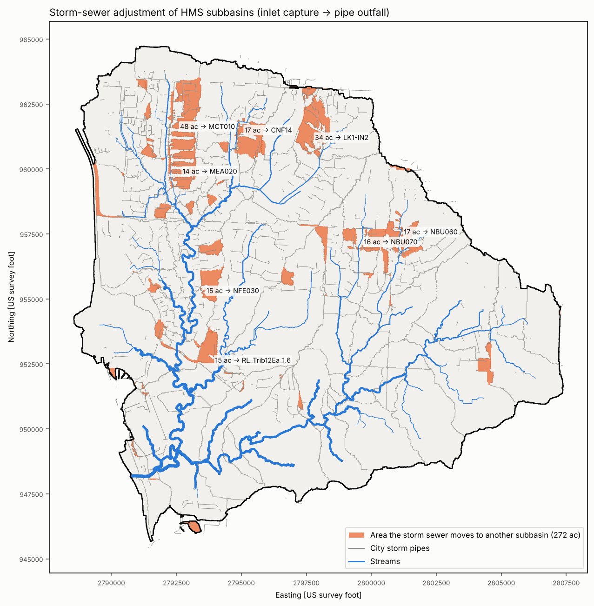

# Storm-sewer adjustment of the HMS subbasins

Storm pipes can carry runoff across a terrain divide, or past the road
crossing that defines a subbasin. The HMS subbasins therefore come from the
terrain **plus** the City of Raymore's public storm-sewer GIS
(`GIS/Raymore_StormGIS.gpkg`: 2,385 pipes and 3,253 structures in the
watershed). The download extends 2,000 ft past the FEMA 2D area so that pipe
systems crossing the watershed edge are complete.

## Method: inlet capture (`scripts/sewer.py`, `02b`)

Overland flow follows the culvert-burned 10 ft terrain (D8), as before. Each
city inlet structure becomes a link in the flow network: runoff that reaches
it goes to the outfall of its pipe system. Included structures are curb, field
and gutter inlets, catch basins, pipe drains, and inflow end sections. The
outfall then discharges into the receiving channel.

1. **Pipe systems:** pipe endpoints are snapped within 5 ft, giving 558
   systems. Each system's outfall is its lowest leaf node, with outfall and
   end-section structures preferred.
   * The city's digitizing direction is not reliable enough to use on its own:
     69 % of pipes slope downhill as drawn and 17 % the other way.
   * Check: of the 43 systems that move ≥ 5 ac, 39 have recorded inverts
     falling toward the chosen outfall (Spearman ρ 0.72–1.0), and pipes
     digitized toward it.
2. **Inlet snapping:** each inlet goes to the highest-accumulation cell within
   15 ft that drains ≤ 10 ac (street and field inlets) or ≤ 40 ac (inflow end
   sections). That is the gutter or swale beside it, never the creek.
3. **In-line conduits are ignored:** if the terrain already carries the inlet's
   flow to the outfall, the link adds nothing (754 such links, mostly road
   culverts).
4. **Cycles** are removed. Result: **1,897 inlet links** that re-route flow
   (`HMS/parameters/sewer_links.csv`).

Delineation (`04`) and parameters (`05`) both use this network. Tc paths that
pass through a pipe travel it at 5 ft/s; 18 of the 61 subbasins include a pipe
segment, median 430 ft.

## Artefacts found and fixed during review

| First result | Cause | Fix |
|---|---|---|
| 1,601 ac moved; subbasins at FEMA crossings (EAG030, NBU040, MEA010 …) emptied | Road culverts in the city layer let flow "jump" past the HMS junction at the crossing | Drop links that follow the terrain path (rule 3) |
| 240 ac of Trib12Ea_1.6 and 138 ac of TribNort_0.2 moved to a neighbour | Inlets and end sections beside the creek snapped onto the creek channel | Cap capture at 10 / 40 ac (rule 2) |
| Confluence `CNF25` renamed `CNF24` | Names are numbered by drainage area | Names matched by location to the previous model; new points take the next number (`CNF28`) |

## Result (`scripts/13_storm_sewer_delineation.py`)

The storm sewer moves **274 ac (5.2 % of the watershed)** between subbasins.
The watershed grows by 3 ac (8.276 → 8.280 sq mi), because pipes bring a few
acres in from outside the terrain divide.

* Largest transfers:

  | From → To | Area | Relation |
  |---|---:|---|
  | CNF17 → MCT010 | 48 ac | east-side sewers discharge into the creek above the MCT010 crossing |
  | LK1-IN1 → LK1-IN2 | 34 ac | both into Silver Lake |
  | TribNort_0.2 → NBU060 | 17 ac | |
  | EAG030 → CNF14 | 17 ac | |
  | NBU030 → NBU070 | 16 ac | |
  | NFE020 → NFE030 | 15 ac | |
  | ECT070 → Trib12Ea_1.6 | 15 ac | |
  | CNF17 → MEA020 | 14 ac | |
  | EAG010 → EAG020 | 8 ac | leaves EAG010 with 0.4 ac (the crossings are 283 ft apart) |

  Full list: `HMS/parameters/sewer_transfers.csv`.
* Only about 20 ac crosses between stream branches (four transfers of 3–6 ac).
  The rest moves to the next subbasin up or down the same stream.
* Silver Lake's direct tributaries were renumbered: two former inflow
  subbasins (LK1-IN4, LK1-IN5) now reach the lake by pipe through other
  inflows. LK1's drainage area is unchanged (0.68 sq mi).

## Effect on HEC-HMS peaks (FEMA 100-yr, HMS 4.14)

| Location | Terrain only | With sewer | Change |
|---|---:|---:|---:|
| J-LK1-IN1 (into Silver Lake) | 69 cfs | 330 cfs | +379 % |
| J-ECT090 | 124 | 192 | +55 % |
| J-MCT010 | 466 | 611 | +31 % |
| J-CNF27 | 469 | 599 | +28 % |
| J-GRA010 | 610 | 773 | +27 % |
| J-RL_TribNort_0.2 | 483 | 402 | −17 % |
| **Outlet J-ECT030** | **7,822** | **7,719** | **−1.3 %** |

The median junction changes by about 0 %. The storm sewer matters for
crossings and culverts inside the watershed, not at the outlet.

## Limits

* **Full capture.** Every inlet's catchment is sent to the outfall. In
  storms beyond the pipe design event (often 10-yr), excess stays on the
  street and follows the terrain. Where it matters (a culvert or a detention
  basin downstream), an HMS Diversion element sized from the pipe capacity
  can split the flow.
* Only 723 of the 3,238 structures (22 %) have a recorded invert, so for
  most systems the direction comes from topology and terrain. That is checked
  where inverts exist, as above.
* Private storm systems not in the city layer are not captured.
