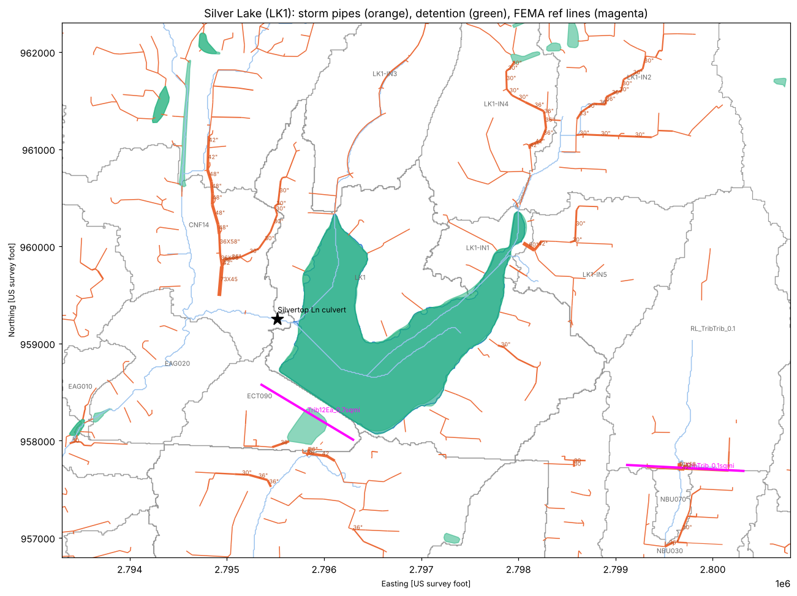

# City of Raymore public data used in the study

## 1. As-built plan library

* Source: the ArcGIS Online dashboard **"Infrastructure Plans – Asbuilt"**
  (<https://raymore.maps.arcgis.com/apps/dashboards/9829c82db8cc4348beb81beaf757dc63>).
  It reads feature layer `eng2386/FeatureServer/10`, which holds the project
  footprints.
* The dashboard's **Public File Share** button is the `linkShare` field (Google Drive).
* `scripts/11_asbuilt_index.py` reads the layer live and keeps the 184 plan sets
  that intersect the watershed. It drops **water-main projects** (type "Water"
  only, or "Water System…" names), leaving 170 documents and 158 unique Drive files:

  | Priority | Meaning | Documents |
  |---|---|---|
  | 1 | storm sewer, storm water, grading or detention | 141 |
  | 2 | type unknown or survey | 4 |
  | 3 | sanitary, street or lighting only | 25 |

* Outputs:
  * `docs/as-builts/raymore_asbuilt_index.csv`: name, type, dates, overlap,
    HMS subbasins touched, Drive ID and public link
  * `GIS/Raymore_Asbuilt_Index.gpkg`: the same, with project footprints
* All 158 files download from the public share (about 5.3 GB). Nine are over
  100 MB and need Drive's virus-scan confirm token; the largest, *Raymore Commerce
  Center 1st*, is 1.0 GB. Every one checked was a scanned image with no text
  layer, so reading them is visual work.
* The PDFs are **not committed**. The index links to the city's copies.

## 2. Stormwater GIS

* Source: `RaymoreGIS2386_S1/FeatureServer` and `outfall/FeatureServer`, in NAD83
  MO West ft, the model's CRS.
* `scripts/12_raymore_storm_gis.py` clips to the watershed plus 500 ft and
  writes `GIS/Raymore_StormGIS.gpkg`:

| Layer | Inside the watershed | Notes |
|---|---|---|
| `detention` (strm_detetion) | **131 basins** | 59 detention, 45 pond, 7 retention, 3 lake, 13 untyped, and others; median 0.46 ac. The layer has a few duplicate polygons (Silver Lake appears twice). |
| `pipes` (strm_swr) | 2,368 pipes, 48 mi | diameter / material labels, average slope, subdivision / as-built IDs |
| `inlets` (strm_inlet) | 3,238 structures | 2,002 curb inlets, 324 outfalls, 281 end sections, 183 junction boxes; 833 have a top elevation and 723 an outflow invert |
| `outfalls` | 3 | MS4 outfall points |

`HMS/parameters/detention_city_gis.csv` lists each basin with its type, area,
HMS subbasin, centroid, and the plan sets covering it. 64 of the 131 have one.
That is where to look for the outlet structure (orifice, weir, riser) of each
basin.

## 3. Questions this data answers

* **The Trib 12 / TribNort "diversion" is Silver Lake.** FEMA's reference line
  `Trib12Ea_0.7sqmi` sits just south of the lake's straight south (dam) edge, and
  0.7 sq mi is the lake's drainage area (model: 0.69). FEMA's naming assumes
  Silver Lake drains south to Trib 12. Everything else says it drains west:
  * the Black & Veatch as-builts put the lake spillway at Silvertop Ln, at the
    west end;
  * the city's storm GIS has no pipe leaving the lake to the south (all 20
    shoreline outfalls discharge into the lake);
  * the terrain and FEMA's own 2D results agree (22 cfs at the 0.7 line in the
    100-yr).

  The model's routing stands. Remaining unknown: a private principal-spillway
  pipe through the south embankment, which would not be in city GIS. The 1986
  *Silver Lake* plan set (78 hand-drawn sheets) may show it.
* **The area west of Silver Lake (`SB-EAG030`, Eagle Glen) does not drain into
  the lake.** Its storm trunk (48 in and 42 in pipe, then 36×58 and 73×45 in
  arches) ends at the western creek, which joins the lake outlet channel below
  the Silvertop culvert. That matches the model and B&V's routing of only the
  lake outflow (about 130 cfs) through the culvert.
* **City Hall detention** is basin OBJECTID 106 in `SB-LK1-IN4` (0.10 ac
  polygon), with its own 2020 as-built (*City Hall Detention*). Its release
  target is 1.8 cfs/ac in the 100-yr (B&V sheet 2).

## 4. What this sets up next

1. **Detention in HMS.** Each city basin becomes a reservoir: stage–storage from
   the 1 m lidar within the polygon, and the outlet from its as-built. Large
   unrouted ponds come first: a 12.7 ac pond in `SB-CNF05` and an 11.9 ac pond
   in `SB-RL_Trib12Ea_1.6`, plus the Good Ranch retention and detention basins
   (5.2–5.5 ac).
2. **Storm sewer routing.** Pipes plus inlet inverts can correct subbasin
   boundaries where sewers cross the terrain divides (e.g. the Sunset Channel
   RCB).
