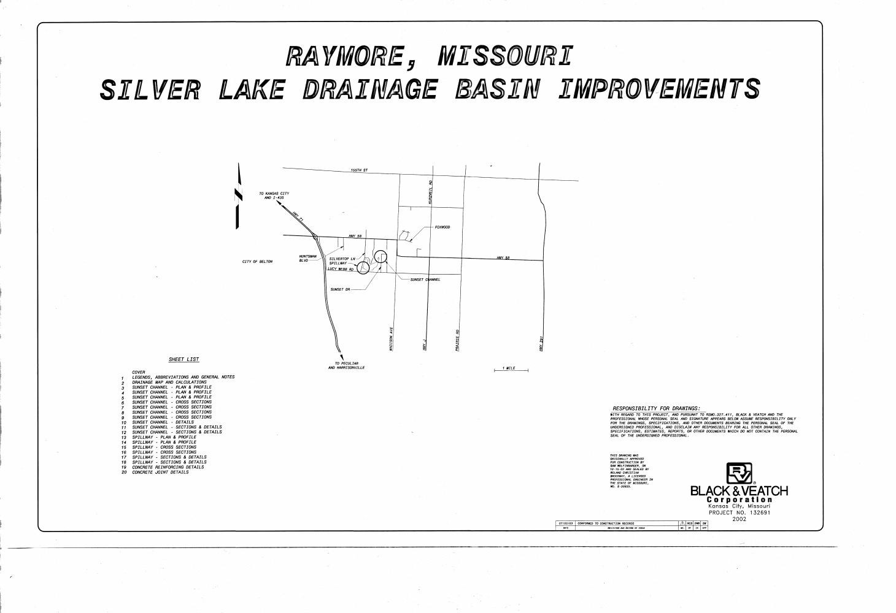
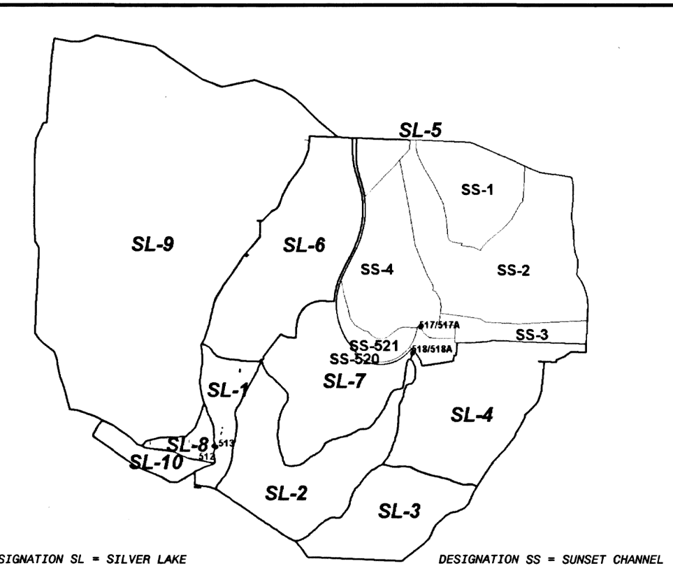

# Silver Lake as-builts – Black & Veatch project 132691

**File:** `Resources/AsBuilts/SilverLake_DrainageBasinImprovements_BV132691_2002.pdf`
(City of Raymore Drive, `silverlake_drainagebasin.pdf`; 21 pages, 36×24 in sheets)

**Title:** Raymore, Missouri – Silver Lake Drainage Basin Improvements, Black &
Veatch, 2002. The title block reads **"Conformed to construction records
07/02/03"**. Designed by RCB, sealed by Roland Christian Brockway (MO E-20935).

**Silver Lake = model lake `LK1`** (52.5 ac, 0.68 sq mi to the outlet; centroid
38.8006, −94.4723, south of Hwy 58 and west of Madison). The outlet is at its
west end under Silvertop Lane.

## What was built and what wasn't

| Sheets | Work | Status in the conformed set |
|---|---|---|
| 3–12 | **Sunset Channel** improvements, NE of the lake (STA 6+08 to 13+68, about 30 ft bottom, 2.5:1 sides) | Built |
| 13–18 | **Spillway** rebuild: lower the outlet channel about 2.5 ft, triple 8×6 ft RCB under Silvertop Ln | **NOT USED** (crossed out, not built) |

Because the spillway work was cancelled, sheets 13–18 document the **existing**
outlet. That is the condition in today's lidar and in FEMA's 2D model.

## Data transcribed (in `scripts/10_asbuilt_silver_lake.py`)

* **Existing Silvertop Ln culvert** (sheet 13, note 2): three cast-in-place
  concrete boxes, 4.3 ft high by 12 ft wide, about 40 ft long, with wingwalls.
  Road crest is about 1035.5 ft. FEMA's model has no structure here, but its
  terrain is open through the road at about 1025 ft.
* **Existing grade along the spillway** (sheet 13 profile, stationing
  increasing downstream/west from the lake): 1025.1 (STA 1+60, lake side of the
  road), 1024.7 (2+40), 1024.4 (2+80), 1023.9 (3+40 to 4+00), 1022.8 (5+20).
  There is an existing weir at about STA 5+32, about 330 ft downstream.
* **Sunset Channel hydrology** (sheet 2, TP-40 Type II; 10-yr 5.64 in, 100-yr
  7.94 in): SS-1 to SS-4 total 127 ac, with cumulative peaks of 291.5 cfs
  (10-yr) and 411.2 cfs (100-yr) at RCB 517/517A. That RCB is 350 ft long at
  0.5 %, 56 sq ft, inverts 1030.11 → 1028.2, and rated 482 cfs flowing full.
* **Detention:** SS-1 is *"occupied by Raymore City Hall, and runoff is limited
  by detention, 1.8 cfs/acre for the 100 yr event"* (35 ac, 63 cfs). It is the
  first entry in `HMS/parameters/detention_inventory.csv`.
* **Silver Lake design hydrology** (sheet 2 spillway table, NOT USED):
  * subareas SL-1 to SL-10 total 580.6 ac, plus SL-2, which isn't listed
  * CN 77–84, lags 3.5–35.8 min
  * SL-9 alone is 281.6 ac with a 1,361 cfs peak
  * **design 100-yr lake outflow 131 cfs**, for the unbuilt, lowered spillway
* **Control** (sheet 2): MO State Plane West ft, the same grid as the model.
  Control benchmark: USGS/MO survey monument, elevation 1083.93. The vertical
  datum is not stated.

Layers are in `GIS/AsBuilts.gpkg`: `SilverLake_Culvert`, `SilverLake_SunsetChannel`
(stations 7+40 to 12+80 were not transcribed), and `SilverLake_ControlPoints`.

## What it means for the HMS model

1. **The LK1 outlet representation holds.** The lake spills through the open
   channel and the existing triple-box culvert, as in the terrain-derived rating.
   * The model's sill (1025.75 ft) is 0.65 ft above the 2002 survey grade at
     STA 1+60 (1025.1 ft).
   * Over STA 1+60 to 4+60 the lidar runs a median 0.5 ft above the survey
     (`HMS/QAQC/silverlake_survey_vs_lidar.csv`).
   * That could be a datum shift (NGVD29 vs NAVD88), sediment, or vegetation.
     Survey the sill to settle it.
2. **The Silvertop Ln culvert never controls in the modeled storms.** HDS-5
   inlet control gives a headwater below the sill-controlled lake stage up to
   about 1,400 cfs, while the largest LK1 outflow is 620 cfs (Point 500-yr).
   See `HMS/QAQC/silverlake_culvert_check.csv`. No model change is needed.
3. **Sensitivity to the sill elevation** (QA engine, which matches HMS within 1 %):

   | Storm | LK1 outflow | J-CNF14 | Outlet |
   |---|---|---|---|
   | FEMA 100-yr | 139 → 201 cfs | +3 % | +0.5 % |
   | Point 100-yr | 292 → 392 cfs | +6 % | +0.6 % |
   | Point 10-yr | 68 → 104 cfs | +2 % | +0.4 % |

   A sill 0.5 ft lower matters for anything designed just downstream of the
   lake, not for the watershed outlet.
4. **Total drainage area agrees, but the internal split differs.**
   * B&V's SL + SS subareas total about 707 ac plus SL-2. The model has 444 ac
     to the lake outlet and 719 ac at J-CNF14, 900 ft below the culvert, after
     the western EAG030 branch (211 ac) joins.
   * B&V routed only the lake outflow (about 130 cfs) through the culvert. That
     suggests their SL-9 (282 ac) drains into the lake, or joins below the
     culvert.
   * **Resolved with the city's storm GIS** (`docs/as-builts/Raymore_city_data.md`):
     the western (Eagle Glen) trunk ends at the western creek, which joins the
     lake outlet channel below the culvert. B&V's SL-9 joins downstream of the
     lake, as the model has it.
5. **The Sunset Channel area is under-represented by the terrain.** It drains
   about 40 ac in the model vs 127 ac in B&V's tables. The 350 ft RCB
   517 → 518 and street sewers carry SS-1 and SS-2 to the channel, which lidar
   can't see. All of it still reaches LK1, so lake inflow volume is right; only
   the timing inside the LK1 subbasins is affected.
6. B&V's 100-yr design outflow (131 cfs, 7.94 in) and the model's (139 cfs at
   7.02 in; about 210 cfs interpolated to 7.94 in) are the same order. Both
   show Silver Lake cutting a 2,000+ cfs inflow to a few hundred cfs. They
   aren't directly comparable, because B&V designed a lowered outlet that was
   never built.

